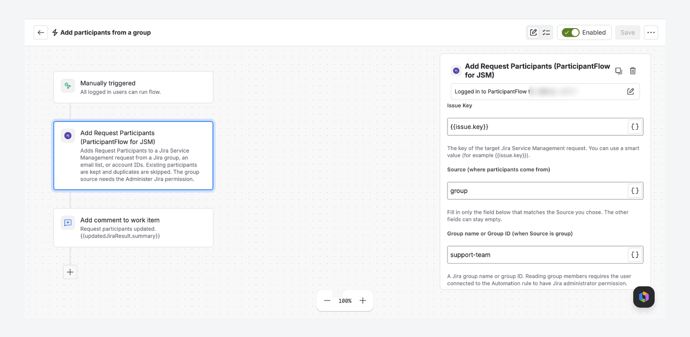

# ParticipantFlow for JSM

Add Request Participants to a Jira Service Management request from a Jira Automation rule, using a Jira group, a list of email addresses, or a list of account IDs.

[Get it on the Atlassian Marketplace](https://marketplace.atlassian.com/apps/2028299522/participantflow-for-jsm) · [Documentation](https://asunokio-official.github.io/participantflow-jsm-docs/documentation.html) · [Quick start](https://asunokio-official.github.io/participantflow-jsm-docs/documentation.html#quick-start)

*Sample site and test data.*

## What it solves

Jira's Request participants field takes individual users, not a group, so adding several people from a rule usually means a hand-built Send web request step and an API token. ParticipantFlow adds one Automation action that does it for you.

## Who it is for

Jira Service Management admins and project admins who build Automation rules and need to add several participants to a request at once.

## What it does

- One action: **Add Request Participants (ParticipantFlow for JSM)**.
- Source can be a **Jira group**, a list of **email addresses**, or a list of **account IDs**.
- Existing participants are kept, and people who are already participants are skipped.
- Returns a summary (added, skipped, failed) that later rule steps can use.
- No API token and no Send web request step.

## Limits to know about

- It only adds participants. It never removes or replaces them.
- The group source needs the connected Atlassian account to have the **Administer Jira** permission.
- A group source adds members who are Jira users. Portal-only customers cannot be in Jira groups, so use the email or account ID source for them.
- Group members are capped at 500 per run.
- A group must exist in Jira. The app does not read groups from an external identity provider. Members are added when the rule runs; it is not a continuous sync.
- If any account ID in a batch is invalid for the request, Jira rejects the whole batch and the step fails.
- Participants may receive notifications, depending on your project settings. Try it on a test request first.

## Install

A Jira administrator installs the app from the [Marketplace listing](https://marketplace.atlassian.com/apps/2028299522/participantflow-for-jsm) with **Try it free**. If you are not an administrator, the listing lets you submit a request to your administrator.

## Support

Email [support@asunoki.jp](mailto:support@asunoki.jp). Issues in this repository are public, so please do not post customer data or confidential details there.

Also see [Native Jira Automation vs ParticipantFlow](https://asunokio-official.github.io/participantflow-jsm-docs/native-automation-vs-participantflow.html) and the [Privacy Policy](https://asunokio-official.github.io/participantflow-jsm-docs/privacy-policy.html).

Vendor: Seisuke Nagahara (ASUNOKI). An independently developed Marketplace app, not affiliated with or endorsed by Atlassian beyond the standard Marketplace listing.
